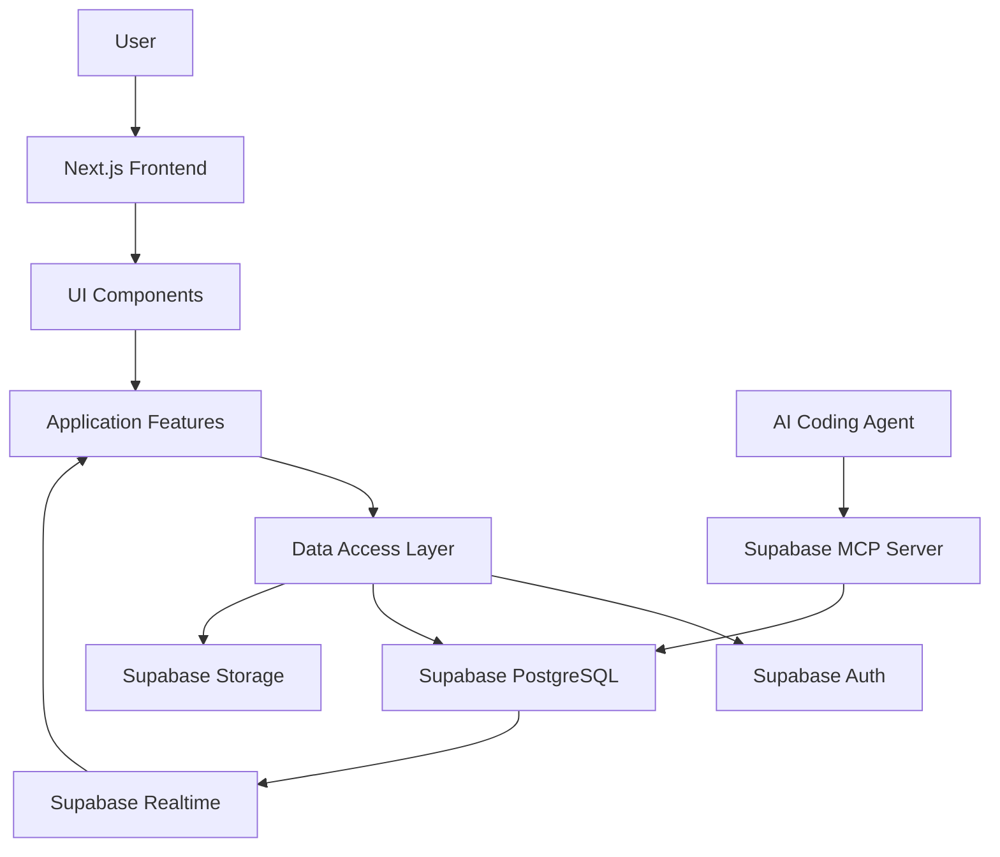

# Project Management App — Architecture

**Version:** 1.0  
**Status:** Initial Draft  
**Architecture Style:** Modular Monolith  
**Frontend:** Next.js + TypeScript  
**Backend:** Supabase  
**Database:** PostgreSQL  
**Development Integration:** Supabase MCP Server

---

## 1. Architecture Overview

The application will follow a modular monolith architecture.

The frontend, application logic, and database access will reside in a single Next.js application, while Supabase will provide managed backend infrastructure.

The system will be divided into five primary layers:

1. Presentation layer — UI components and pages.
2. Application layer — feature-specific business logic.
3. Data access layer — typed queries and mutations.
4. Backend layer — Supabase services.
5. Development tooling — MCP integration and database migrations.

The architecture must support future expansion without introducing unnecessary complexity during MVP development.

### High-Level Architecture



The frontend communicates with Supabase through its official JavaScript client.

Supabase remains the source of truth for application data. The frontend must not independently maintain authoritative copies of project or task records.

---

## 2. Frontend Architecture

### 2.1 Technology Stack

| Technology | Responsibility |
|---|---|
| Next.js App Router | Application routing and rendering |
| React | Component-based UI |
| TypeScript | Type safety |
| Tailwind CSS | Utility-first styling |
| shadcn/ui | Reusable accessible UI primitives |
| Lucide React | Consistent icon system |
| Framer Motion | Interface animations |
| TanStack Query | Server-state caching and mutations |
| Zustand | Lightweight client-side state |
| React Hook Form | Form management |
| Zod | Runtime validation |
| dnd-kit | Kanban drag-and-drop interactions |
| date-fns | Date formatting and manipulation |

The frontend must use a consistent design system rather than mixing unrelated component libraries.

### 2.2 Rendering Strategy

Use Next.js App Router with server components as the default.

Server components will handle:

- Initial page rendering.
- Loading authenticated workspace data.
- Fetching project information.
- Rendering static layouts.
- Reducing unnecessary client-side JavaScript.

Client components will handle:

- Interactive Kanban boards.
- Drag-and-drop functionality.
- Dialogs and dropdowns.
- Search and filtering interactions.
- Real-time subscriptions.
- Form state and optimistic updates.

Use client-side rendering only where interactivity requires it.

### 2.3 Application Layout

The authenticated application will use a persistent sidebar and a flexible main content area.

```text
┌───────────────────────────────────────────────────────────┐
│ Workspace     Search                 Notifications Avatar │
├──────────────┬────────────────────────────────────────────┤
│              │                                            │
│  Overview    │                                            │
│              │                                            │
│  Projects    │             Main Content                   │
│              │                                            │
│  My Tasks    │       Dashboard / Kanban / List             │
│              │                                            │
│  Members     │                                            │
│              │                                            │
│  Settings    │                                            │
│              │                                            │
└──────────────┴────────────────────────────────────────────┘
```

The layout must support:

- Collapsible sidebar.
- Workspace switching.
- Persistent project navigation.
- Global search.
- User profile menu.
- Notification access.
- Responsive mobile navigation.

On mobile, the sidebar will become a drawer or compact navigation menu.

---

## 3. Modern UI and Design System

The application should look like a premium, contemporary SaaS product.

The interface should feel polished without becoming visually complicated.

### 3.1 Visual Direction

Use a clean, minimal interface inspired by modern productivity tools.

Design principles:

- Neutral backgrounds with restrained accent colors.
- Clear typography and strong information hierarchy.
- Consistent spacing and alignment.
- Subtle borders and shadows.
- Rounded cards and interactive surfaces.
- Smooth transitions and micro-interactions.
- High information density without visual clutter.

The application must prioritize usability over decorative effects.

### 3.2 Color System

Use semantic design tokens instead of hardcoded colors.

Initial palette:

| Token | Purpose |
|---|---|
| Background | Main application background |
| Surface | Cards, panels, and dialogs |
| Primary | Primary actions and active elements |
| Secondary | Secondary actions |
| Muted | Supporting text and inactive elements |
| Border | Dividers and component boundaries |
| Success | Completed tasks and positive feedback |
| Warning | Approaching deadlines |
| Destructive | Errors and destructive actions |

Support both light and dark themes.

The selected theme must persist across page navigation.

Use CSS variables to define the design tokens and integrate them with Tailwind CSS.

### 3.3 Typography

Use a modern sans-serif font such as Geist or Inter.

Typography must distinguish:

- Page titles.
- Section headings.
- Card titles.
- Body text.
- Supporting information.
- Labels and metadata.

Avoid excessive font sizes, heavy font weights, and unnecessary capitalization.

### 3.4 Component System

Use shadcn/ui as the foundation for reusable interface components.

Required components:

- Button
- Input
- Textarea
- Select
- Checkbox
- Dropdown menu
- Dialog
- Sheet
- Popover
- Tooltip
- Tabs
- Avatar
- Badge
- Card
- Table
- Command
- Skeleton
- Toast notifications

All components must follow the same spacing, typography, color, and interaction rules.

Custom components should compose these primitives rather than recreate their functionality.

### 3.5 Interaction Design

Every interactive element must provide clear feedback.

Examples:

- Buttons show hover, focus, active, and disabled states.
- Dialogs open and close with subtle transitions.
- Task cards respond visually during drag operations.
- Forms show validation errors near the relevant fields.
- Loading operations use skeletons or inline progress indicators.
- Successful mutations show concise confirmation.
- Destructive operations require confirmation where appropriate.

Use Framer Motion for small, purposeful transitions.

Avoid animations that delay user actions or reduce usability.

---

## 4. Application Routing

Use Next.js App Router with route groups for authentication and the main application.

### 4.1 Proposed Route Structure

```text
/
├── (auth)/
│   ├── login/
│   ├── signup/
│   └── reset-password/
│
├── (app)/
│   ├── dashboard/
│   ├── my-tasks/
│   ├── notifications/
│   │
│   ├── [workspaceId]/
│   │   ├── page.tsx
│   │   ├── projects/
│   │   │   ├── new/
│   │   │   └── [projectId]/
│   │   │       ├── page.tsx
│   │   │       ├── board/
│   │   │       ├── list/
│   │   │       └── settings/
│   │   ├── members/
│   │   └── settings/
│   │
│   └── settings/
│       └── profile/
│
├── api/
│   └── webhooks/
│
└── layout.tsx
```

### 4.2 Routing Rules

- Public routes must remain accessible without authentication.
- Authenticated routes must require a valid user session.
- Workspace routes must validate membership.
- Project routes must validate access to the associated workspace.
- Invalid or unauthorized resources must not expose protected data.

Use route parameters for workspace and project identifiers.

Task details should support direct navigation through a task-specific URL or a shareable task link.

---

## 5. Frontend Folder Structure

The codebase will follow a feature-oriented structure.

```text
src/
├── app/
│   ├── (auth)/
│   ├── (app)/
│   ├── api/
│   ├── layout.tsx
│   └── globals.css
│
├── components/
│   ├── ui/
│   ├── layout/
│   ├── shared/
│   └── feedback/
│
├── features/
│   ├── auth/
│   ├── workspaces/
│   ├── projects/
│   ├── tasks/
│   ├── board/
│   ├── comments/
│   ├── notifications/
│   └── dashboard/
│
├── lib/
│   ├── supabase/
│   ├── query/
│   ├── utils/
│   └── constants/
│
├── hooks/
├── types/
└── config/
```

Each feature should contain its own:

- Components.
- Hooks.
- API or data access functions.
- Validation schemas.
- Types.
- Utility functions.

Shared components must not contain feature-specific business logic.

---

## 6. Backend Architecture

Supabase will provide the application's backend infrastructure.

### 6.1 Supabase Services

| Service | Responsibility |
|---|---|
| Supabase Auth | User authentication and sessions |
| PostgreSQL | Persistent application data |
| Row Level Security | Database authorization |
| Realtime | Live updates |
| Storage | Task attachments and profile images |
| Edge Functions | Secure server-side operations when required |

The initial application will use Supabase directly without a separate custom backend server.

Next.js Route Handlers and Supabase Edge Functions may be introduced for operations requiring privileged server-side execution.

### 6.2 Data Access Pattern

All database access must pass through a consistent data access layer.

Example:

```text
Kanban Board
     ↓
Task Feature Hook
     ↓
Task Data Access Function
     ↓
Supabase Client
     ↓
PostgreSQL + RLS
```

Components must not contain large, duplicated database queries.

Use feature-specific data access functions such as:

```typescript
getProjectTasks(projectId)
createTask(input)
updateTask(taskId, input)
moveTask(taskId, status, position)
deleteTask(taskId)
```

These functions must validate inputs and handle errors consistently.

### 6.3 Server and Browser Supabase Clients

Maintain separate Supabase clients for server-side and browser-side usage.

Server-side client:

- Uses the authenticated server session.
- Handles protected server rendering.
- Must never expose privileged credentials.
- Must enforce user-level access through RLS.

Browser-side client:

- Uses the authenticated user session.
- Handles interactive mutations.
- Supports Realtime subscriptions.
- Must use only the public Supabase key.

The Supabase service-role key must never be included in browser bundles.

---

## 7. State Management

The application will use three distinct state categories.

### 7.1 Server State

Use TanStack Query for data fetched from Supabase.

Examples:

- Projects.
- Tasks.
- Workspace members.
- Comments.
- Notifications.

Responsibilities:

- Query caching.
- Background refetching.
- Mutation handling.
- Cache invalidation.
- Optimistic updates.

### 7.2 Client State

Use Zustand for lightweight shared UI state.

Examples:

- Sidebar visibility.
- Active workspace selection.
- Open task panel.
- Temporary board filters.
- UI preferences.

Avoid storing complete server records in Zustand.

### 7.3 Form State

Use React Hook Form with Zod validation.

Forms must:

- Validate required fields.
- Display clear error messages.
- Prevent duplicate submissions.
- Show loading states.
- Handle server errors.
- Preserve user input when an operation fails.

---

## 8. Kanban Board Architecture

The Kanban board is one of the application's most important features.

It must support smooth interactions while preserving data consistency.

### 8.1 Board Components

```text
BoardPage
└── BoardView
    ├── BoardToolbar
    ├── BoardFilters
    ├── BoardColumns
    │   ├── BoardColumn
    │   │   ├── ColumnHeader
    │   │   ├── TaskCard
    │   │   └── TaskCard
    │   └── BoardColumn
    └── TaskDetailsPanel
```

### 8.2 Drag-and-Drop

Use dnd-kit for drag-and-drop functionality.

When a task is moved:

1. Update the UI immediately.
2. Determine the new status and position.
3. Send the mutation to Supabase.
4. Persist the task's updated status and position.
5. Reconcile the UI with the server response.
6. Roll back the optimistic update if the mutation fails.

The board must avoid unnecessary full-page reloads.

### 8.3 Task Ordering

Tasks will use a numeric or fractional ordering value within each status column.

The ordering strategy must support:

- Reordering within a column.
- Moving tasks between columns.
- Concurrent updates from multiple users.
- Efficient database queries.

The implementation must avoid renumbering every task for routine drag operations.

### 8.4 Real-Time Synchronization

Subscribe to task changes for the active project.

When a task changes:

- Update the relevant task in the local cache.
- Preserve unrelated board state.
- Avoid unnecessary full-board refetches.
- Handle reconnects and duplicate events safely.

Supabase Realtime events should trigger targeted cache updates or invalidation.

---

## 9. MCP Architecture

MCP will connect the development environment to Supabase.

It will not be part of the application's runtime request flow.

### 9.1 Development Workflow

```text
Developer
    ↓
AI Coding Agent
    ↓
Supabase MCP Server
    ↓
Development Supabase Project
    ↓
PostgreSQL Database
```

The coding agent may use MCP to inspect schemas, execute approved queries, and assist with database development.

### 9.2 Database Migration Workflow

Database schema changes must be version-controlled.

```text
Developer Request
       ↓
AI Agent + Supabase MCP
       ↓
Proposed Schema Change
       ↓
SQL Migration File
       ↓
Review and Testing
       ↓
Development Database
       ↓
Production Deployment
```

MCP-generated database changes must not bypass migration management.

The application must support development and deployment without an active MCP connection.

### 9.3 MCP Security

- Connect MCP only to the intended development environment.
- Use the least privileged credentials available.
- Never expose database credentials to client-side code.
- Require approval for destructive database operations.
- Keep production database access restricted.
- Review generated SQL before applying production changes.

---

## 10. Authentication and Authorization Flow

Authentication will use Supabase Auth.

```text
User Login
    ↓
Supabase Auth
    ↓
Authenticated Session
    ↓
Next.js Middleware / Server Checks
    ↓
Workspace Membership Validation
    ↓
RLS-Protected Database Access
```

Frontend checks are for user experience.

Database RLS policies remain the authoritative access control mechanism.

The application must verify workspace membership before rendering protected workspace content.

---

## 11. Performance Strategy

The application must remain responsive as projects and task counts grow.

### 11.1 Frontend Performance

- Use server components for initial data rendering.
- Keep client-side bundles small.
- Lazy-load noncritical dialogs and panels.
- Avoid unnecessary global state.
- Use memoization only where it provides measurable benefit.
- Use optimistic updates for frequent interactions.
- Paginate large task lists.
- Avoid rendering all workspace data on every page.

### 11.2 Database Performance

- Index frequently filtered columns.
- Use composite indexes for common query patterns.
- Avoid fetching unused columns.
- Paginate large result sets.
- Use database constraints for data integrity.
- Monitor slow queries.
- Optimize RLS policies as the dataset grows.

### 11.3 Realtime Performance

Realtime subscriptions must be scoped to the active workspace or project.

Avoid opening one subscription for every task or component.

Clean up subscriptions when components unmount or users navigate away.

---

## 12. Error Handling and Reliability

All application operations must use consistent error handling.

The UI must distinguish between:

- Authentication errors.
- Authorization errors.
- Validation errors.
- Network errors.
- Database errors.
- Unexpected application errors.

Failed mutations must not leave the UI in an incorrect state.

The application must provide:

- Loading states.
- Empty states.
- Error states.
- Retry mechanisms.
- Clear user feedback.
- Safe optimistic update rollback.

Sensitive technical details must not be exposed in user-facing error messages.

---

## 13. Testing Architecture

### Unit Tests

Use Vitest for:

- Utility functions.
- Validation schemas.
- Data transformation logic.
- Permission helper functions.

### Component Tests

Use React Testing Library for:

- Forms.
- Dialogs.
- Task cards.
- Board interactions.
- Loading and error states.

### End-to-End Tests

Use Playwright for:

- Authentication.
- Workspace creation.
- Project creation.
- Task management.
- Drag-and-drop behavior.
- Workspace permission enforcement.
- Multi-user collaboration.

### Database Tests

Test:

- Foreign key constraints.
- RLS policies.
- Role-based permissions.
- Task assignment restrictions.
- Database migration correctness.

Security tests must verify that unauthorized users cannot access protected records directly through the Supabase API.

---

## 14. Deployment Architecture

### Development

- Next.js development server.
- Local Supabase or dedicated development project.
- Supabase MCP Server.
- Version-controlled database migrations.

### Production

- Next.js deployed on Vercel.
- Supabase production project.
- Production PostgreSQL database.
- Supabase Auth and Realtime.
- Production environment variables.

Production and development environments must use separate credentials and databases.

Database migrations must be reviewed and applied through a controlled deployment process.

---

## 15. Architectural Decisions

The initial architecture will follow these decisions:

1. Use a modular monolith rather than microservices.
2. Use Next.js App Router and TypeScript.
3. Use Tailwind CSS and shadcn/ui for the frontend.
4. Use server components by default.
5. Use Supabase as the primary backend.
6. Use PostgreSQL as the source of truth.
7. Use RLS for authorization.
8. Use TanStack Query for server state.
9. Use Zustand for lightweight UI state.
10. Use dnd-kit for Kanban interactions.
11. Use Supabase Realtime for collaboration.
12. Use MCP for development assistance, not runtime execution.
13. Keep database changes version-controlled.
14. Prioritize maintainability and MVP delivery over premature complexity.

---

## 16. Implementation Order

The architecture should be implemented in the following order:

1. Initialize Next.js, TypeScript, Tailwind CSS, and shadcn/ui.
2. Establish the design system and application layout.
3. Configure Supabase and MCP.
4. Create database migrations and RLS policies.
5. Implement authentication.
6. Implement workspace and project management.
7. Implement task management.
8. Build the Kanban board.
9. Integrate Realtime synchronization.
10. Implement dashboard and notifications.
11. Add testing and deployment automation.

The first implementation milestone is a polished application shell with authentication, workspace navigation, and a working Supabase connection.
